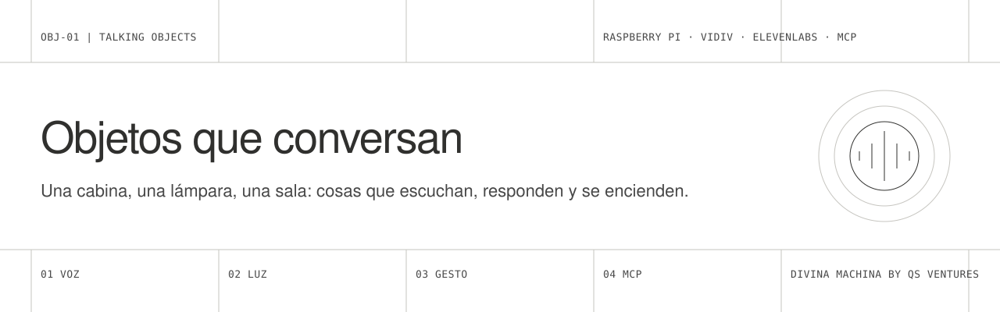
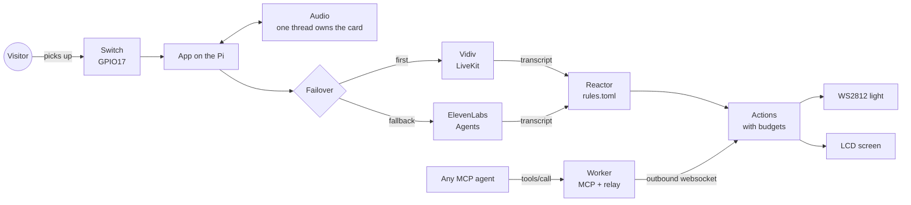

<picture>
  <source media="(prefers-color-scheme: dark)" srcset="docs/assets/banner-dark.svg">
  
</picture>

<p><a href="README.md">Español</a></p>

A kit for building **objects that hold a conversation**: a phone booth, a lamp, a sculpture or a room that listens to whoever comes close, answers with a voice and reacts with light and gestures. It runs on a **Raspberry Pi 5**, talks to **Vidiv** and **ElevenLabs** agents with automatic failover between them, and opens its lights and screens to any agent through **MCP**.

It comes from **TeleTUP**, the booth through which GAIA 2147 talks to the public at fairs and festivals. This repo does not include GAIA's character, prompts or call data: only the technique, so you can build your own.

The full guides are in Spanish, in [`docs/`](docs). This page summarises them.

## What is inside

| | Part | What it does |
|---|---|---|
| 01 | [`device/`](device) | The Raspberry Pi program: audio, trigger, Vidiv, ElevenLabs, failover, lights, screen, reactor rules and a status page. Python 3.11+. |
| 02 | [`worker/`](worker) | A Cloudflare Worker with an MCP server and a relay: agents call tools and the orders reach the Pi, even behind a venue's NAT. TypeScript. |
| 03 | [`docs/`](docs) | Six guides: hardware, agents, experience design, MCP, lights and field operation. |
| 04 | [`examples/`](examples) | Three starting experiences: booth, listening object, room. |

## How it works



1. **The voice never depends on one provider.** Vidiv goes first; if it does not connect, ElevenLabs takes over while the ringback tone plays. A circuit breaker keeps the next visitor from paying for the same failure.
2. **The object reacts to the conversation by itself.** The reactor reads the transcript and fires lights or screen messages from simple rules, without the agent spending turns or adding latency. The agent can still ask for gestures over MCP or RPC.
3. **One door to the hardware.** Agent, rules and MCP all go through the same action registry, which validates, limits (per call, per day, cooldown) and logs. A failing light never stops a conversation.

## Five minutes, no hardware

```bash
git clone https://github.com/olmedcr-cmyk/talking-objects.git && cd talking-objects/device
python3 -m venv .venv && .venv/bin/pip install -r requirements.txt
cp config.example.env config.env && cp rules.example.toml rules.toml
FAKE_AUDIO=1 TRIGGER_MODE=keyboard .venv/bin/python -m talking_objects -v
```

`s` + Enter starts a conversation, `e` + Enter ends it. The status page is at `http://localhost:8081`. To make it really talk, fill in the Vidiv or ElevenLabs credentials in `config.env`.

## On a Raspberry Pi 5

```bash
scp -r device pi@object.local:~/talking-objects
ssh pi@object.local
cd ~/talking-objects && ./deploy/install.sh
```

The idempotent installer enables I2C and SPI, creates the environment, points ALSA at the USB sound card and installs a systemd service. Bill of materials and wiring: [docs/01-raspberry.md](docs/01-raspberry.md).

## MCP

```bash
cd worker && npm install
npx wrangler secret put DEVICE_KEY && npx wrangler secret put MCP_KEY
npx wrangler deploy
```

Set `LINK_URL=wss://<your-worker>/device/connect?key=<DEVICE_KEY>` on the Pi and point your agent at `https://<your-worker>/mcp`. The tools it sees are the actions the Pi announces: add an action on the device and it shows up as a tool.

## Tested

- 19 device tests and 4 MCP server tests, run in CI on every change.
- A local end-to-end run: the Worker under `wrangler dev`, the device with null audio connected through the tunnel, `tools/list` and `tools/call` from outside. The order reaches the Pi, and the refusal of an invalid colour comes back to the agent.
- Audio, provider failover and wiring come from TeleTUP, which runs at fairs. This kit is a lighter version of that code and **has not yet been assembled as-is on a Pi**: the first installation is the missing test.

## Privacy

By default the object **does not store transcripts** (`STORE_TRANSCRIPTS=0`) and the status page is read-only. In a public space people have not agreed to be remembered; if you change that, do it on purpose and with a visible notice.

## Credits

Designed and maintained by **Divina Machina by Qs Ventures** (Cris Olmedo and Kurt Sommer). Voice by [Vidiv](https://vidiv.com) and [ElevenLabs](https://elevenlabs.io); Vidiv's transport is [LiveKit](https://livekit.io). [MIT](LICENSE) licence.
