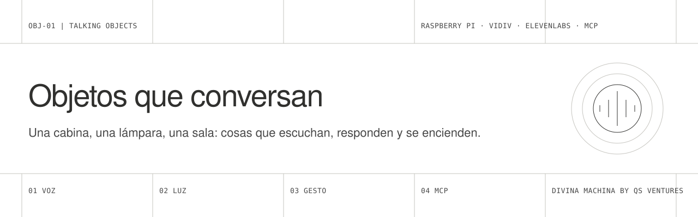
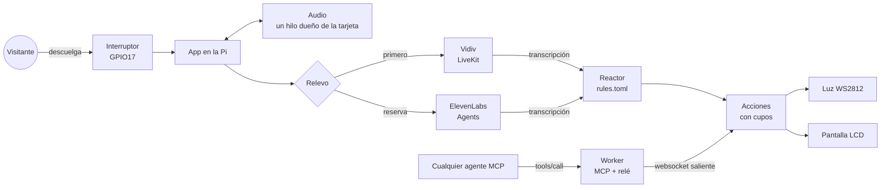

<picture>
  <source media="(prefers-color-scheme: dark)" srcset="docs/assets/banner-dark.svg">
  
</picture>

<p>
  <a href="README.en.md">English</a> ·
  <a href="docs/01-raspberry.md">Raspberry</a> ·
  <a href="docs/02-agentes.md">Agentes</a> ·
  <a href="docs/03-experiencias.md">Experiencias</a> ·
  <a href="docs/04-mcp.md">MCP</a> ·
  <a href="docs/05-luces-y-perifericos.md">Luces</a> ·
  <a href="docs/06-operacion.md">Operación</a>
</p>

Un kit para construir **objetos que conversan**: una cabina telefónica, una lámpara, una escultura o una sala que escucha a quien se acerca, le responde con voz y reacciona con luz y gestos. Corre en una **Raspberry Pi 5**, habla con agentes de **Vidiv** y de **ElevenLabs** con relevo automático entre los dos, y abre sus luces y pantallas a cualquier agente mediante **MCP**.

Sale de **TeleTUP**, la cabina con la que GAIA 2147 conversa con el público en ferias y festivales. Este repo no incluye el personaje de GAIA, sus prompts ni datos de llamadas: solo la técnica, para que puedas construir el tuyo.

## Qué hay dentro

| | Pieza | Qué hace |
|---|---|---|
| 01 | [`device/`](device) | El programa de la Raspberry: audio, interruptor, Vidiv, ElevenLabs, relevo, luces, pantalla, reglas y página de estado. Python 3.11+. |
| 02 | [`worker/`](worker) | Un Worker de Cloudflare con un servidor MCP y un relé: los agentes llaman a las tools y las órdenes bajan hasta la Pi, aunque esté detrás del NAT de un recinto. TypeScript. |
| 03 | [`docs/`](docs) | Seis guías: hardware, agentes, diseño de experiencias, MCP, luces y operación en campo. |
| 04 | [`examples/`](examples) | Tres experiencias de partida: cabina, objeto que escucha y sala. |

## Cómo funciona



Tres ideas sostienen el diseño:

1. **La voz nunca depende de un solo proveedor.** Vidiv va primero; si no conecta, ElevenLabs entra mientras suenan los tonos de espera y el visitante no se entera. Un cortacircuitos evita que el siguiente visitante pague el mismo fallo.
2. **El objeto reacciona solo a la conversación.** El reactor lee la transcripción y enciende luces o escribe en la pantalla según reglas sencillas, sin que el agente gaste turnos ni añada latencia. El agente también puede pedir gestos por MCP o por RPC cuando quiera.
3. **Una sola puerta al hardware.** Agente, reglas y MCP pasan por el mismo registro de acciones, que valida, limita (por llamada, por día, con espera) y registra. Una luz que falla nunca corta una conversación.

## Empezar en cinco minutos, sin hardware

```bash
git clone <este-repo> talking-objects && cd talking-objects/device
python3 -m venv .venv && .venv/bin/pip install -r requirements.txt
cp config.example.env config.env && cp rules.example.toml rules.toml
FAKE_AUDIO=1 TRIGGER_MODE=keyboard .venv/bin/python -m talking_objects -v
```

Con `s` + Enter empieza una conversación y con `e` + Enter termina. La página de estado queda en `http://localhost:8081`. Para que hable de verdad, rellena en `config.env` las credenciales de Vidiv o de ElevenLabs ([guía de agentes](docs/02-agentes.md)).

## En una Raspberry Pi 5

```bash
scp -r device pi@objeto.local:~/talking-objects
ssh pi@objeto.local
cd ~/talking-objects && ./deploy/install.sh
```

El instalador es idempotente: activa I2C y SPI, crea el entorno, configura ALSA para la tarjeta USB y deja un servicio de systemd. Lista de materiales, cableado y primeros pasos en la [guía de la Raspberry](docs/01-raspberry.md).

## El MCP

```bash
cd worker && npm install
npx wrangler secret put DEVICE_KEY && npx wrangler secret put MCP_KEY
npx wrangler deploy
```

Luego pon `LINK_URL=wss://<tu-worker>/device/connect?key=<DEVICE_KEY>` en la Pi y apunta tu agente a `https://<tu-worker>/mcp`. Las tools que verá son las acciones que la Pi anuncia: si añades una acción en el dispositivo, aparece sola como tool. Detalles en la [guía del MCP](docs/04-mcp.md).

## Probado

- 19 tests del dispositivo y 4 del servidor MCP, en CI con cada cambio.
- Prueba de punta a punta en local: el Worker en `wrangler dev`, el dispositivo con audio nulo conectado por el túnel, `tools/list` y `tools/call` desde fuera. La orden llega a la Pi y el rechazo de un color inválido vuelve al agente.
- El audio, el relevo entre proveedores y el cableado vienen de TeleTUP, que funciona en ferias. Este kit es una versión más ligera de ese código y **aún no se ha montado tal cual en una Pi**: la primera instalación es la prueba que falta.

## Privacidad

Por defecto el objeto **no guarda transcripciones** (`STORE_TRANSCRIPTS=0`) y la página de estado es de solo lectura. En un espacio público la gente no ha aceptado que la recuerden; si cambias eso, que sea a propósito y con aviso visible. Hay más en [diseño de experiencias](docs/03-experiencias.md#ética-y-privacidad).

## Estructura

```
talking-objects/
├── device/                    # Raspberry Pi
│   ├── talking_objects/       # app, audio, providers, devices, reactor, link, status
│   ├── tests/
│   ├── deploy/                # install.sh, servicio systemd, asound.conf
│   ├── config.example.env
│   └── rules.example.toml
├── worker/                    # Cloudflare Worker: MCP + relé
│   ├── src/                   # index.ts, mcp.ts, relay.ts
│   └── test/
├── examples/                  # cabina, objeto, sala
└── docs/                      # guías y figuras
```

## Créditos

Diseñado y mantenido por **Divina Machina by Qs Ventures** (Cris Olmedo y Kurt Sommer). La voz llega con [Vidiv](https://vidiv.com) y [ElevenLabs](https://elevenlabs.io); el transporte de Vidiv es [LiveKit](https://livekit.io). Licencia [MIT](LICENSE).

> La máquina siempre estuvo ahí; la ponemos en conversación con lo humano.
