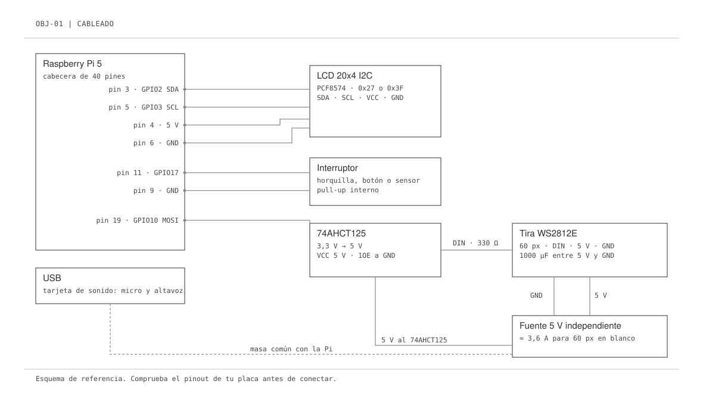

# 01 · La Raspberry

La Raspberry Pi 5 es el cuerpo del objeto: oye por un micrófono, habla por un altavoz, nota cuándo alguien se acerca y mueve luces y pantallas. Todo corre en un solo proceso de Python, sin navegador ni kiosco.

## Lista de materiales

| | Pieza | Notas |
|---|---|---|
| 01 | Raspberry Pi 5 | Con la fuente oficial USB-C de 27 W. Una fuente floja da cortes de audio difíciles de diagnosticar. |
| 02 | microSD de 32 GB o más, clase A2 | O un SSD por PCIe si el objeto va a estar meses en marcha. |
| 03 | Tarjeta de sonido USB | Con entrada de micro y salida de altavoz. El instalador la detecta y la deja por defecto. |
| 04 | Micro y altavoz | Un auricular de teléfono, una cápsula y un altavoz pequeño, o un altavoz con micro. |
| 05 | Interruptor | La horquilla de un teléfono, un pulsador, un sensor de presencia con salida a contacto. |
| 06 | Tira WS2812E (opcional) | 60 píxeles en el ejemplo. |
| 07 | Fuente de 5 V para la tira | Independiente de la Pi. 60 píxeles en blanco pleno piden unos 3,6 A. |
| 08 | 74AHCT125 | Convierte los 3,3 V de la Pi a los 5 V que espera la tira. Sin él falla a ratos. |
| 09 | Condensador de 1000 µF y resistencia de 330 Ω | Entre 5 V y GND de la tira, y en serie con la línea de datos. |
| 10 | LCD 20x4 con mochila I2C (opcional) | PCF8574, dirección 0x27 o 0x3F. |

## Cableado



| Señal | Pin físico | GPIO | Va a |
|---|---|---|---|
| Interruptor | 11 | GPIO17 | Un polo del interruptor; el otro, a GND (pin 9). Pull-up interno. |
| Datos de la tira | 19 | GPIO10 (SPI0 MOSI) | Entrada A del 74AHCT125; su salida Y, por la resistencia de 330 Ω, a DIN de la tira. |
| I2C SDA | 3 | GPIO2 | SDA del LCD. |
| I2C SCL | 5 | GPIO3 | SCL del LCD. |
| 5 V | 4 | — | VCC del LCD. |
| GND | 6, 9 | — | LCD, interruptor y **masa común** con la fuente de la tira. |

> En la Pi 5 la librería clásica `rpi_ws281x` no funciona: usaba el DMA y el PWM de los chips BCM y la Pi 5 lleva el chip RP1. El kit saca la señal de la tira por SPI con `adafruit-circuitpython-neopixel-spi`, que sí funciona.

Comprueba siempre el pinout de tu placa antes de conectar. Con la Pi apagada.

## Sistema

1. Graba **Raspberry Pi OS Lite (64 bits, Bookworm)** con Raspberry Pi Imager. En los ajustes avanzados pon nombre de equipo (`objeto`), usuario, wifi y SSH con clave pública.
2. Arranca y entra: `ssh pi@objeto.local`.
3. Copia el código y ejecuta el instalador:

```bash
scp -r device pi@objeto.local:~/talking-objects
ssh pi@objeto.local
cd ~/talking-objects && ./deploy/install.sh
sudo reboot   # solo si el instalador activó I2C o SPI por primera vez
```

El instalador hace siete cosas y se puede repetir sin romper nada:

1. Instala los paquetes del sistema, entre ellos `python3-lgpio`, el acceso a GPIO de la Pi 5.
2. Activa I2C y SPI.
3. Añade tu usuario a `gpio`, `spi`, `i2c` y `audio`.
4. Crea `.venv` con acceso a los paquetes del sistema e instala `requirements.txt`.
5. Detecta la tarjeta USB y escribe `/etc/asound.conf`.
6. Copia `config.example.env` y `rules.example.toml` si aún no existen.
7. Instala y habilita el servicio `talking-objects`.

## Primera prueba

```bash
cd ~/talking-objects
nano config.env                                      # credenciales: ver 02 · Agentes
TRIGGER_MODE=keyboard .venv/bin/python -m talking_objects -v
```

`s` + Enter abre una conversación; `e` + Enter la cierra. Cuando suene bien, arranca el servicio:

```bash
sudo systemctl start talking-objects
journalctl -u talking-objects -f
```

## Comprobaciones rápidas

| Qué | Comando |
|---|---|
| ¿Ve la tarjeta de sonido? | `aplay -l` y `arecord -l` |
| ¿Suena el altavoz? | `speaker-test -t sine -f 440 -l 1` |
| ¿Graba el micro? | `arecord -d 3 -f S16_LE -r 48000 /tmp/p.wav && aplay /tmp/p.wav` |
| ¿Dónde está el LCD? | `sudo i2cdetect -y 1` |
| ¿Está activo SPI? | `ls /dev/spidev*` |

Siguiente: [02 · Agentes](02-agentes.md).
