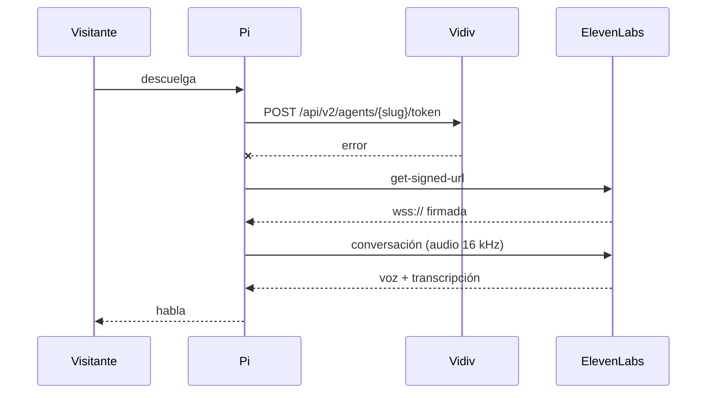

# 02 · Agentes: Vidiv y ElevenLabs

El objeto no tiene personaje propio: lo pone un agente conversacional en la nube. El kit habla con dos plataformas y usa las dos a la vez, con **Vidiv primero y ElevenLabs de reserva**. Es la misma arquitectura de GAIA 2147: un personaje, dos plataformas y relevo automático.

## Por qué dos

En una feria la red falla, los servicios tienen picos y una cabina muda es una cabina rota. Con dos proveedores:

- **Si uno no conecta**, el otro entra mientras suenan los tonos de espera. El visitante solo nota que tardó un segundo más.
- **Si uno falla dos veces seguidas** (`BREAKER_FAILURES`), cede el primer puesto durante cinco minutos (`BREAKER_COOLDOWN_S`). Así el siguiente visitante no paga el mismo fallo.
- **Si uno se cae en mitad de una conversación**, no se migra el contexto, porque no se puede. La llamada termina y ese proveedor pasa al final de la cola.



| `PROVIDER_MODE` | Comportamiento |
|---|---|
| `auto` | Vidiv primero y ElevenLabs de reserva. Si faltan las credenciales de ElevenLabs, arranca igual sin reserva y lo avisa en el log. |
| `vidiv` | Solo Vidiv. |
| `elevenlabs` | Solo ElevenLabs. |

## Vidiv

Vidiv entrega el agente y usa [LiveKit](https://livekit.io) para llevar el audio. En cada conversación la Pi:

1. Pide un token nuevo con `POST {VIDIV_API_BASE}/api/v2/agents/{VIDIV_AGENT_SLUG}/token`. El cuerpo lleva idioma y metadatos; la respuesta trae `data.token`.
2. Se une a la sala de LiveKit (`LIVEKIT_URL`) con ese token.
3. Publica el micrófono y se suscribe a la voz del agente.
4. Registra cada acción del objeto como **método RPC** de LiveKit, para que el agente pueda invocarlas.
5. Escucha la transcripción, que LiveKit ya manda como flujo de texto (`lk.transcription`).

Configuración en `config.env`:

```ini
VIDIV_AGENT_SLUG=tu-agente
LIVEKIT_URL=wss://…           # el servidor LiveKit de tu cuenta de Vidiv
LANGUAGE=es
```

Regla de Vidiv que el kit respeta: **un token nuevo en cada conversación** y nunca reutilizar la sesión anterior. Para ganar tiempo, la Pi acuña el token siguiente al terminar cada visita (`prefetch`) y lo tira si cambia el contexto.

> El slug no es una clave, pero quien lo tenga puede hablar con tu agente y gastar tu cuota. Trátalo como semisecreto.

## ElevenLabs

ElevenLabs Agents entra con su SDK nativo de Python. En cada conversación la Pi:

1. Pide una URL firmada con `GET /v1/convai/conversation/get-signed-url?agent_id=…`, usando la API key solo en ese momento.
2. Abre la conversación con un puente de audio propio, que convierte de 48 kHz a 16 kHz y vuelve a subir la voz.
3. Registra cada acción del objeto como **client tool**. Declara en la configuración del agente, en ElevenLabs, las client tools con el mismo nombre (`light`, `show_message`…), para que el modelo sepa que existen.
4. Recibe la transcripción por los callbacks del SDK.

```ini
ELEVENLABS_AGENT_ID=agent_…
ELEVENLABS_API_KEY=sk_…
```

El contexto que empuja el Worker (por ejemplo, `{"mood": "calma"}`) llega al agente como **variables dinámicas**: usa `{{mood}}` en su prompt.

Las versiones del SDK están fijadas en `requirements.txt`. El aviso de fin de sesión (`callback_end_session`) se comprobó contra `elevenlabs==2.66.0`. Sin él, una conexión caída dejaría al visitante con el auricular mudo. Antes de subir de versión, revísalo y pasa los tests.

## El mismo personaje en las dos plataformas

El relevo solo funciona si el visitante no nota el cambio. Dale al agente de ElevenLabs el mismo prompt, la misma voz o una muy parecida, el mismo idioma y las mismas tools que al de Vidiv. Prueba los dos por separado con `PROVIDER_MODE=vidiv` y `PROVIDER_MODE=elevenlabs` antes de dejar `auto`.

## Qué decirle al agente sobre su cuerpo

El agente no sabe que vive en un objeto si no se lo dices. En el prompt:

- **Dónde está y cómo le hablan.** «Respondes desde una cabina telefónica en una feria. Quien te habla acaba de descolgar».
- **Qué puede hacer.** «Puedes cambiar tu luz con `light` cuando cambie el tono de la conversación. Úsala poco».
- **Qué no puede hacer.** «No recuerdas a nadie entre llamadas. No pidas datos personales».
- **Cómo termina.** «Si alguien se despide, despídete en una frase».

Las descripciones de las tools son parte del personaje: el modelo las lee. Escríbelas como una indicación de **cuándo** usarlas, no como documentación de una API. Están en `device/talking_objects/app.py`.

## Tres caminos para un gesto

| Camino | Quién decide | Latencia | Cuándo usarlo |
|---|---|---|---|
| Reactor (`rules.toml`) | Reglas sobre la transcripción | Ninguna para el agente | Por defecto: el objeto parece vivo sin coste. |
| RPC (Vidiv) o client tool (ElevenLabs) | El agente, en plena conversación | Baja, va por la misma conexión | Gestos que el personaje decide. |
| MCP (Worker) | Cualquier agente, de dentro o de fuera de la llamada | Un viaje más por internet | Agentes sin canal directo, o control desde otros sistemas. |

Los tres pasan por el mismo registro de acciones, con los mismos cupos.

Siguiente: [03 · Experiencias](03-experiencias.md).
