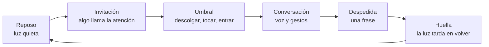

# 03 · Diseñar la experiencia

La técnica de este repo es lo de menos para quien se acerca. Lo que vive es un encuentro: alguien ve un objeto, duda, se atreve, conversa y se va con algo. Esta guía reúne lo que hemos aprendido diseñando ese encuentro.

## Tres arquetipos

| | Arquetipo | Gesto que inicia | Por qué funciona | Ejemplo |
|---|---|---|---|---|
| 01 | **Cabina** | Descolgar un auricular | Todo el mundo sabe qué hacer con un teléfono. El auricular aísla del ruido de la sala y da intimidad. | [`examples/cabina`](../examples/cabina) |
| 02 | **Objeto que escucha** | Tocar, acercarse o pulsar | Un objeto cotidiano (una lámpara, una radio, un busto) que de pronto contesta. La sorpresa es parte de la pieza. | [`examples/objeto`](../examples/objeto) |
| 03 | **Sala** | Entrar en un espacio | La voz y la luz llenan el lugar. Varias personas a la vez, más teatro que confidencia. | [`examples/sala`](../examples/sala) |

## El arco de un encuentro

- **Reposo.** El objeto apagado parece roto. Dale una luz de reposo baja y cálida (`LED_IDLE_COLOR`). Si no puede hablar, por ejemplo porque falta el audio, la luz pasa a ámbar fijo: es la diferencia entre «apagado» y «averiado».
- **Invitación.** Una frase en un cartel, un timbre o una luz que respira. Una sola cosa, no tres.
- **Umbral.** El gesto que inicia tiene que ser obvio y físico. El kit lo trata como un interruptor: horquilla, pulsador o sensor (`TRIGGER_MODE=gpio`).
- **Conversación.** El primer segundo decide todo. Que el agente hable primero y corto. Mientras conecta, suenan tonos: el silencio se lee como fallo.
- **Despedida.** El agente cierra en una frase. Colgar termina la conversación al instante, con el límite de `MAX_CALL_SECONDS` como red.
- **Huella.** Que la luz no se apague de golpe. Un objeto que «se queda pensando» unos segundos se recuerda más.

## Luz

- **Menos es más.** Una luz que cambia con cada frase deja de significar. Los cupos del registro (`cooldown_s`, `per_call`) existen para eso.
- **Un color, un sentido.** Decide qué significa cada color y no lo mezcles: si el azul es memoria, que no sea también tristeza.
- **Efectos lentos.** `breathe` para estados de ánimo, `pulse` para un instante, `solid` para quedarse.
- **El reactor primero.** Las reglas de `rules.toml` hacen que la luz siga la conversación sin que el agente decida nada. Deja las tools para los gestos que el personaje elige a propósito.

## Sonido

- **Auricular antes que altavoz abierto** en sitios ruidosos. Si usas altavoz, ajusta `MIC_DUCK_DB`: súbelo si el agente se oye a sí mismo y se corta; bájalo si cuesta interrumpirle.
- **Tonos de espera.** Mientras se conecta, el relevo puede tardar uno o dos segundos más. Un tono de llamada convierte esa espera en parte de la ficción.
- **El silencio también cuenta.** Si nadie habla, que el agente no rellene. Una pausa bien puesta es contenido.

## El personaje

- **Una voz, un lugar, un tiempo.** GAIA, por ejemplo, llama desde el año 2147. Cuanto más concreto es el personaje, menos explica y más conversa.
- **Saber qué cuerpo tiene.** El prompt le dice dónde está, qué puede tocar y qué no. Mira la [guía de agentes](02-agentes.md#qué-decirle-al-agente-sobre-su-cuerpo).
- **Igual en las dos plataformas.** El relevo entre Vidiv y ElevenLabs tiene que ser inaudible.

## Ética y privacidad

Un objeto que conversa en un espacio público habla con personas que no firmaron nada. Las reglas por defecto del kit:

1. **No guarda transcripciones** (`STORE_TRANSCRIPTS=0`). Lo dicho sirve para reaccionar en el momento y se olvida.
2. **No recuerda a nadie entre conversaciones.** Cada llamada empieza de cero, con un token nuevo.
3. **La página de estado es de solo lectura** y no muestra lo dicho salvo que lo actives.
4. **Aviso visible.** Un cartel junto al objeto: «Conversas con una inteligencia artificial. No guardamos lo que dices».
5. **Menores.** Una cabina pública recibe niños. El prompt no debe pedir datos personales a nadie.
6. **Datos agregados, nunca frases.** Si mides la experiencia, cuenta llamadas, duraciones y gestos, no lo que dijo cada persona.

Si una pieza necesita recordar, que sea con consentimiento explícito, con caducidad y con la posibilidad de borrar.

## En campo

- **Modo automático** (`TRIGGER_MODE=auto`): si el interruptor se rompe en plena feria, el objeto conversa en bucle con descansos. Es mejor que una pieza muerta.
- **Prueba los dos proveedores** la víspera, por separado.
- **Lleva una tarjeta de sonido USB de repuesto.** Es la pieza que más falla.
- Más en [06 · Operación](06-operacion.md).

Siguiente: [04 · MCP](04-mcp.md).
