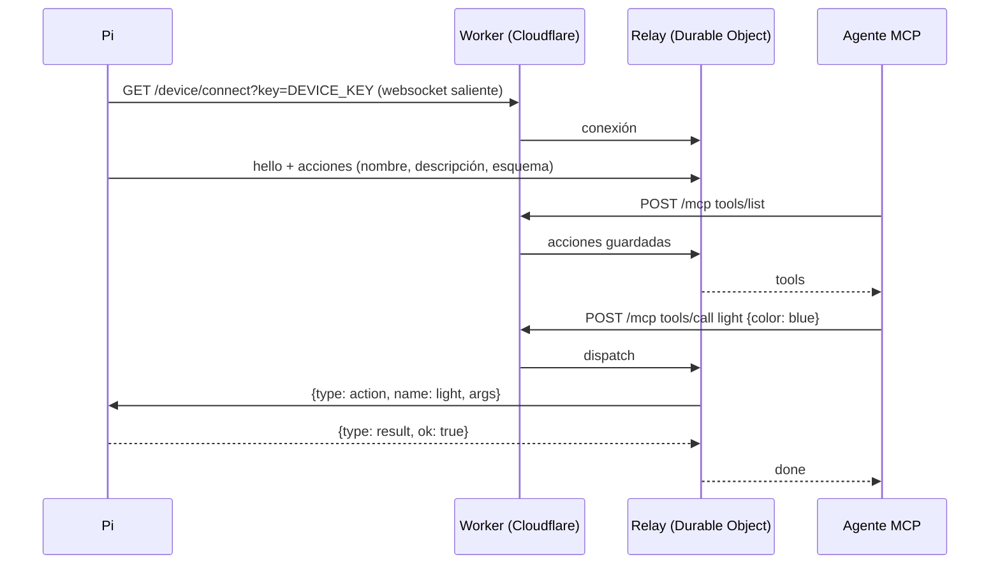

# 04 · MCP: abrir el objeto a cualquier agente

[MCP](https://modelcontextprotocol.io) (Model Context Protocol) es el estándar con el que un agente descubre y usa herramientas. El Worker de este repo es un **servidor MCP** cuyas herramientas son las acciones de tu objeto: encender la luz, escribir en la pantalla o lo que añadas.

## El problema que resuelve

La Pi suele estar detrás del NAT de un recinto, sin dirección pública: nadie en internet puede llamarla. Así que se invierte el sentido:



Sin puertos abiertos, sin software de túnel y sin dominio propio. La Pi reconecta sola, con espera creciente, si se cae el wifi.

## Desplegar el Worker

Necesitas una cuenta de Cloudflare (el plan gratuito sirve para empezar) y Node 20 o superior.

```bash
cd worker
npm install
npx wrangler login
npx wrangler secret put DEVICE_KEY     # lo usa la Pi para conectarse
npx wrangler secret put MCP_KEY        # lo usan los agentes
npx wrangler secret put ADMIN_KEY      # opcional: para empujar contexto
npx wrangler deploy
```

Genera claves largas y aleatorias, por ejemplo con `openssl rand -hex 32`. En la Pi:

```ini
LINK_URL=wss://talking-objects.<tu-subdominio>.workers.dev/device/connect?key=<DEVICE_KEY>
```

Para varios objetos con un solo Worker, añade `&device=<nombre>` a la URL de la Pi y a la del MCP: cada nombre tiene su propio relé.

## Rutas

| Ruta | Para | Autenticación |
|---|---|---|
| `GET /device/connect` | El websocket de la Pi | `?key=DEVICE_KEY` |
| `POST /mcp` | Clientes MCP | `Authorization: Bearer MCP_KEY` |
| `POST /mcp/<MCP_KEY>` | Clientes que solo aceptan una URL | La clave va en la ruta |
| `POST /context` | Empujar contexto a la Pi | `Authorization: Bearer ADMIN_KEY` |
| `GET /status` | ¿Está conectada la Pi? | Pública, sin datos |

## Conectar un agente

El servidor habla MCP sobre **Streamable HTTP** (JSON-RPC 2.0 por POST): `initialize`, `tools/list`, `tools/call` y `ping`.

- **Vidiv.** Configura en tu agente un servidor MCP con la URL `https://<worker>/mcp/<MCP_KEY>`. Así recibe GAIA sus tools.
- **ElevenLabs.** Puedes añadir el mismo servidor MCP al agente o usar client tools, que van por la propia conversación (ver [02 · Agentes](02-agentes.md#tres-caminos-para-un-gesto)).
- **Claude y otros clientes MCP.** Añade un conector remoto con la misma URL. Así puedes controlar el objeto desde fuera de la conversación, por ejemplo para preparar una escena antes de abrir.

Para probarlo a mano:

```bash
W=https://<worker>; K=<MCP_KEY>
curl -s -H "Authorization: Bearer $K" -X POST $W/mcp \
  -d '{"jsonrpc":"2.0","id":1,"method":"tools/list"}'
curl -s -H "Authorization: Bearer $K" -X POST $W/mcp \
  -d '{"jsonrpc":"2.0","id":2,"method":"tools/call","params":{"name":"light","arguments":{"color":"blue","effect":"breathe"}}}'
```

## Respuestas que no rompen la conversación

- Si la Pi está desconectada, la tool **no devuelve error**: responde «el objeto no está disponible ahora; sigue sin él». Una luz que no se enciende no puede cortar la pieza.
- Si la Pi rechaza la orden (color desconocido o cupo agotado), el agente recibe `refused: …` con el motivo y puede corregir.
- El Worker espera como mucho 1,5 s la confirmación de la Pi. La Pi confirma en cuanto valida, sin esperar al hardware.

## Añadir una acción

Una acción nueva en la Pi aparece sola como tool en el MCP en cuanto la Pi reconecta. Ejemplo: un relé en GPIO27 que enciende una máquina de humo.

```python
# device/talking_objects/app.py, dentro de App._register_actions
from gpiozero import OutputDevice
fog = OutputDevice(27)

async def fog_burst(args):
    fog.on()
    await asyncio.sleep(args["seconds"])
    fog.off()

self.actions.register(
    "fog",
    fog_burst,
    description="Suelta niebla unos segundos cuando la conversación se vuelva misteriosa. Muy pocas veces.",
    schema={"type": "object",
            "properties": {"seconds": {"type": "number", "minimum": 1, "maximum": 5}},
            "required": ["seconds"]},
    validate=lambda a: {"seconds": max(1.0, min(float(a.get("seconds", 2)), 5.0))},
    budget=Budget(per_call=1, per_day=40, cooldown_s=60),
)
```

Valida siempre los argumentos y pon cupos a todo lo que consuma algo: papel, líquido o paciencia.

## Empujar contexto

`POST /context` manda un objeto JSON a la Pi, que lo pasa a los proveedores para la siguiente conversación. En Vidiv viaja en los metadatos del token y en ElevenLabs como variables dinámicas. Sirve para que el personaje cambie con algo de fuera: la hora, el tiempo, el aforo o un estado de ánimo calculado.

```bash
curl -s -H "Authorization: Bearer $ADMIN_KEY" -X POST $W/context -d '{"mood":"calma"}'
```

## Seguridad

- Tres claves distintas para tres papeles. Cámbialas si alguna se filtra: `wrangler secret put` y redeploy.
- `MCP_KEY` en la ruta es cómodo pero queda en los registros de quien la use. Prefiere la cabecera `Authorization` cuando el cliente lo permita.
- Las acciones validan sus argumentos en la Pi, no en el Worker: el último control está junto al hardware.

Siguiente: [05 · Luces y periféricos](05-luces-y-perifericos.md).
